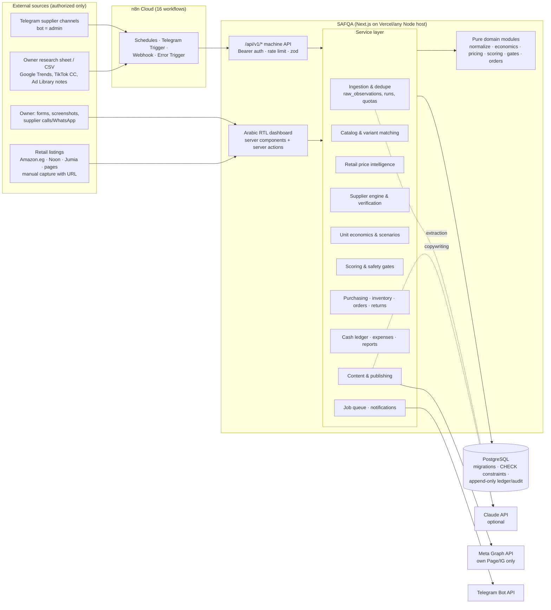

# SAFQA — Architecture

## Overview

## Separation of concerns

| Concern | Module | Notes |
|---|---|---|
| Data ingestion | `services/ingestion.ts`, `services/trends.ts`, `api/v1/ingest/*` | Every item becomes a `raw_observation` (source, method, collected_at, content hash). The unique key (source, hash) makes reruns idempotent. Runs are logged in `ingestion_runs`, and per-source daily quotas are enforced. |
| AI analysis | `adapters/ai.ts`, `services/automation.ts` | Structured output validated with zod, token and cost logging in `ai_usage`, monthly budget cap, deterministic fallback. AI output never overwrites prices and never marks anything verified. |
| Source verification | `services/suppliers.ts` (`recordVerification`) | Only a human user can create an availability verification (`verified_by` is NOT NULL and the service rejects n8n/system actors). Verifications expire. |
| Price intelligence | `domain/pricing.ts`, `services/retail.ts` | Exact-variant comparison. Excludes mismatched, unreviewed, historical, stale, duplicate and outlier offers (IQR plus median ratio), and compares customer totals including shipping. |
| Supplier matching | `domain/normalize.ts`, `domain/supplierPost.ts` | Arabic normalization, attribute extraction (capacity, dimensions, wattage, mAh, pack, weight, model, colour, material). **Any attribute conflict blocks a match**, and auto-matches are only ever "probable". |
| Financial calculations | `domain/economics.ts` | Expected value per shipped order. Failed deliveries, customer returns, COD fees, carrier cost and shipping-fee income are each handled separately. Includes scenarios, cash-basis break-even and maximum CAC. |
| Scoring & gates | `domain/scoring.ts`, `domain/gates.ts` | Weighted 0–100 heuristic with Arabic explanations and a data-confidence level. Gates apply regardless of score. |
| Inventory & orders | `services/inventory.ts`, `services/orders.ts`, `domain/orders.ts` | Movement-based stock with on_hand/reserved/in_transit/sold/defective buckets. DB CHECKs prevent overselling. Weighted-average landed cost, and a COGS snapshot is taken at shipment. |
| Cash | `services/cash.ts`, `services/expenses.ts` | `cash_ledger` is the single source of truth and is append-only through a trigger. Every payment, expense, collection, refund and carrier fee is a ledger row. |
| Content & publishing | `services/marketing.ts`, `adapters/meta.ts` | Drafts → approval → schedule → publish. A post can only be `published` when it has an external post id (DB CHECK). Out-of-stock products are not published. |
| Notifications | `services/notifications.ts`, `adapters/telegram.ts` | Pending → sent / failed / skipped. Never marked sent silently. |
| Jobs | `services/jobs.ts` | Postgres queue (`FOR UPDATE SKIP LOCKED`) with idempotency keys, exponential backoff, dead-letter alerts and recovery of stuck jobs. |
| Dashboard | `src/app/(app)/*` | Server-rendered Arabic RTL. Mutations go through server actions wrapped in `act()`, which handles auth, role checks, flash messages and error mapping. |

## Key invariants (enforced in the database)
- `inventory_levels`: `on_hand ≥ 0`, `reserved ≤ on_hand`, and every bucket ≥ 0, so overselling is impossible.
- `cash_ledger` and `audit_logs`: UPDATE and DELETE raise an exception, so the history can't be rewritten.
- `cash_ledger.amount` sign must match `entry_type` (for example, an expense can't be positive).
- `trend_signals`: an `ai_hypothesis` can't carry measured growth numbers.
- `availability_verifications.verified_by` is required (human only), and `valid_until > verified_at`.
- `scheduled_posts`: status `published` requires `external_post_id`.
- `purchase_orders`: `quantity_received ≤ quantity_ordered` and `paid_amount ≤ total_cost`.
- `environment_stamp`: the database environment (production/demo/test) is fixed at the first migration. A mismatch stops the migrator.

## Security
- Owner login uses bcrypt (cost 12), an HS256 JWT session cookie (HttpOnly, SameSite=Lax, Secure in production, 12 h) and a DB-backed login rate limit (5 attempts per 15 min per IP+email). Middleware protects every page, and each request re-checks the user is still active in the DB.
- Roles: `owner`, `operator` and `viewer`. Purchase approval, payments, budgets, settings and users are owner-only.
- Machine API: `Authorization: Bearer N8N_WEBHOOK_SECRET` (constant-time compare, ≥ 24 chars), rate-limited to 120 requests/min, with zod validation and no stack traces in responses.
- The Telegram direct webhook checks `X-Telegram-Bot-Api-Secret-Token`.
- Secrets live only in environment variables, and `.env*` is gitignored.
- Security headers include HSTS, X-Frame-Options DENY, nosniff and Referrer-Policy. Robots are disabled.
- Customer data is limited to what's needed for delivery: name, phone, city and address.

## Daily operating flow
1. **06:30–07:10 (n8n):** sheet/CSV ingestion → freshness → supplier matching → duplicate flags → profitability and scoring (`daily_research`).
2. **08:00:** a Telegram summary goes out, built from database facts only.
3. **Owner review in the dashboard:** check evidence, call or WhatsApp suppliers, record the verification, confirm the variant match, request a purchase, then approve.
4. **Post-purchase:** record the payment, receive the goods (landed cost is applied), generate and approve content, schedule posts, and process orders (confirm → pack → ship → deliver/fail → return → reconcile).
5. **Throughout the day:** a job worker runs every 15 minutes, notifications dispatch, due posts publish every 30 minutes, and low-stock checks run daily.
