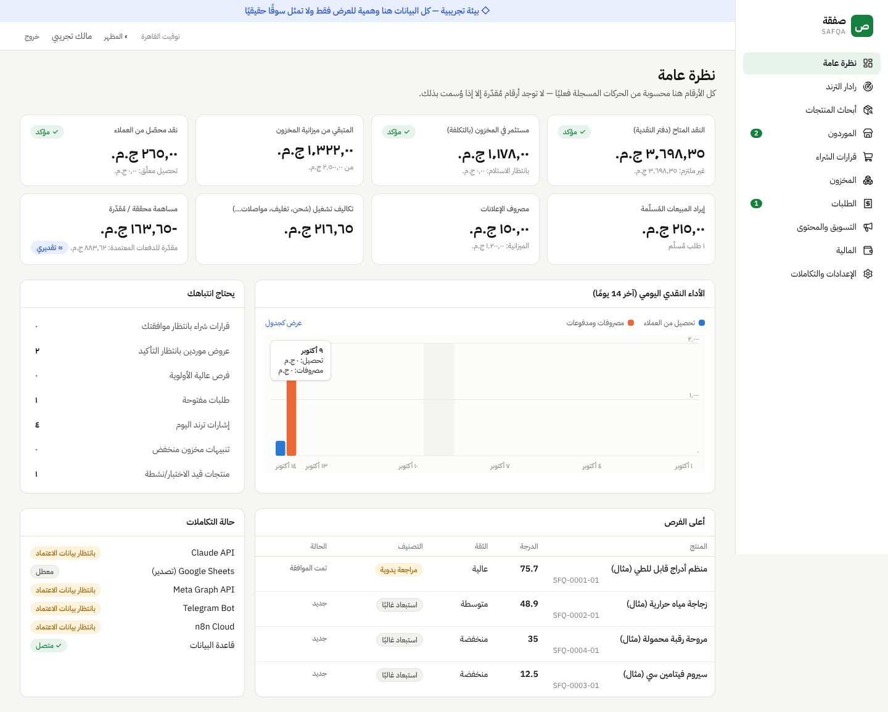

# صفقة | SAFQA

An AI-assisted commerce platform for an Egyptian micro-commerce business. It handles evidence-backed product discovery, comparison of Egyptian retail prices against wholesale quotes, realistic profitability, owner-approved test purchases, inventory, orders, cash and marketing. The dashboard is in Arabic (RTL).

> **Go live:** [DEPLOYMENT.md](DEPLOYMENT.md) · [docs/GO_LIVE_REPORT.md](docs/GO_LIVE_REPORT.md) · [docs/TELEGRAM_SETUP.md](docs/TELEGRAM_SETUP.md)
>
> Start with: [PROJECT_PLAN.md](PROJECT_PLAN.md) · [ARCHITECTURE.md](ARCHITECTURE.md) · [DATA_SOURCES.md](DATA_SOURCES.md) · [TASKS.md](TASKS.md) · [docs/N8N_SETUP.md](docs/N8N_SETUP.md) · [docs/API.md](docs/API.md)



## Stack
Next.js 15 (App Router, server actions) · TypeScript (strict) · Tailwind CSS v4 (shadcn-style components) · PostgreSQL 14+ (`postgres` driver, plain SQL migrations) · Vitest · n8n Cloud · Telegram Bot API · Meta Graph API · Claude API (optional)

## Project structure
```
migrations/               SQL migrations (schema, reference data)
src/lib/domain/           Pure logic: normalize, economics, pricing, scoring, gates, orders, trust labels
src/lib/services/         DB-backed services (ingestion, catalog, trends, retail, suppliers, analysis,
                          purchasing, inventory, orders, cash, expenses, marketing, jobs, reports…)
src/lib/adapters/         External platforms: telegram.ts, meta.ts, ai.ts
src/lib/auth/             Session (JWT cookie), rate limiting, machine API auth
src/app/(app)/            Dashboard pages: overview, trends, products, suppliers, purchases,
                          inventory, orders, marketing, finance, settings
src/app/api/              /api/v1/* machine API for n8n, /api/telegram/webhook, /api/health
n8n/build-workflows.ts    Generates the 16 importable workflows → n8n/workflows/*.json
scripts/                  migrate, create-admin, seed-demo (demo DB only)
tests/unit, tests/integration
```

## Local setup
Requirements: Node 20+ and PostgreSQL 14+.

```bash
npm install
cp .env.example .env            # fill DATABASE_URL, SESSION_SECRET (openssl rand -base64 48), N8N_WEBHOOK_SECRET
createdb safqa
npm run db:migrate              # stamps the DB with SAFQA_ENV (production by default)
npm run db:create-admin -- you@example.com "اسمك"    # prompts for a password (12+ chars)
npm run dev                     # http://localhost:3000
```
On first login, go to **الإعدادات ← رأس المال** and record the capital you actually have (for example 5,000). Budget gates use the cash ledger, not a hard-coded number.

### Optional demo environment
You can use a *separate* database for a walkthrough:
```bash
createdb safqa_demo
DATABASE_URL=postgres://…/safqa_demo SAFQA_ENV=demo npm run db:migrate
DATABASE_URL=postgres://…/safqa_demo npm run db:seed-demo     # refuses to run on a non-demo DB
```
Every page in the demo environment shows a banner. All demo URLs point to `example.invalid`.

## Deployment
Step-by-step: **[DEPLOYMENT.md](DEPLOYMENT.md)** (Neon + Vercel, one-time `/setup` owner page, migrate-on-build).

1. **Database:** a managed Postgres such as Supabase or Neon. Set `DATABASE_URL` and `DATABASE_SSL=require`, then run `npm run db:migrate` once from your machine or CI.
2. **App:** Vercel (or any Node host: Railway, Render, a VPS with `npm run build && npm start`). Set every variable from `.env.example`. Keep test and production credentials separate.
3. Create the owner account against the production DB with `db:create-admin`.
4. **n8n:** follow [docs/N8N_SETUP.md](docs/N8N_SETUP.md).
5. **Backups:** turn on your provider's daily backups or PITR. Supabase/Neon free tiers have limited retention, so also run a weekly `pg_dump` to encrypted storage.

## Environment variables
See [.env.example](.env.example). Required: `DATABASE_URL`, `SESSION_SECRET`, `SAFQA_ENV`. Required for automations: `N8N_WEBHOOK_SECRET`. Optional: `TELEGRAM_*`, `ANTHROPIC_API_KEY`, `META_*`.

## Testing
```bash
createdb safqa_test               # or set TEST_DATABASE_URL
npm test                          # unit + integration (integration uses a real Postgres)
npm run typecheck
npm run build
npm run preflight                 # deployment config/DB/migrations/owner check (PASS/WARN/FAIL)
BASE_URL=… N8N_WEBHOOK_SECRET=… npm run security:check   # black-box auth & security checks
BASE_URL=… N8N_WEBHOOK_SECRET=… npm run test:e2e         # full product workflow (demo DB only)
```
**Latest results:** 6 files, **71 tests passed**, 0 failed. Typecheck clean, production build OK. See [docs/TEST_RESULTS.md](docs/TEST_RESULTS.md) for the mapping to the brief's acceptance criteria and the manual browser/API checks.

## Monthly operating cost (estimate, verify current pricing before enabling)
| Item | Option | Est. monthly | Notes |
|---|---|---|---|
| Hosting | Vercel Hobby | $0 | Vercel's Hobby plan is for **non-commercial** use, so a business should use Pro (~$20) or a ~$5–7 Railway/Render instance |
| Database | Supabase Free / Neon Free | $0 | Small storage limits; Supabase free projects pause after inactivity. Paid tier ~$25 (Supabase Pro) or ~$19 (Neon Launch) |
| n8n Cloud | Owner's existing plan | Existing | All 16 active ≈ 4,000 scheduled executions/month (publishing every 30 min is the largest). The recommended starter set ≈ 1,500/month — check your plan's quota in n8n → Usage |
| Telegram Bot API | — | $0 | |
| Meta Graph API | — | $0 | Ad spend is separate and comes from the advertising budget |
| Claude API | Optional | ~$0.5–5 | Capped by the "AI monthly budget" setting (default $5). Extraction is low-volume |
| Domain | Optional | ~$1 | |
| **Total** | | **~$0–30 / month** | **No paid dependency is enabled by default** |

## Known limitations
- **No automated trend scraping.** TikTok Creative Center, Google Trends, the Meta Ad Library for commercial ads in Egypt, Noon and Jumia have no authorized APIs we can use, so data enters through owner entry, CSV or an owner-maintained sheet (see DATA_SOURCES.md).
- **Telegram, Meta and Claude integrations** are implemented and tested against mocked APIs. **They haven't been exercised against the live services yet**, because no credentials were available. Each one reports its status in Settings and records failures.
- Matching is rule-based (normalization, attribute conflicts, trigram similarity). There's no image similarity yet, and the owner confirms every match.
- Scores are configurable heuristics, not validated predictions.
- Carrier fees are booked when a shipment is created. Courier APIs (for example Bosta) aren't integrated, so delivery status is entered manually.
- The order form creates single-item orders (the service supports several items).
- The cash ledger is single-currency (EGP), and VAT handling is a simple configurable percentage.
